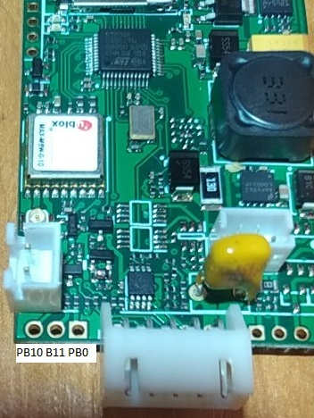

# Blinkee IoT Board Reverse Engineering

PCB mapping and diagnostic firmware for a scooter IoT board built around **STM32F030CCT6**, **u-blox SARA-G340**, **MAX-M8W** and **KX124**.

[Polski](README.pl.md) · [Pin map and hardware](docs/HARDWARE.md) · [Diagnostic sketch and UART commands](docs/DIAGNOSTICS.md) · [Source](blinkee_iot_diag.ino)

## What is included

| Part | Contents |
| --- | --- |
| Board research | Components, traced signals, ESC connector and photos |
| Diagnostic sketch | ADC/GPIO readouts, I²C scan, accelerometer check, GNSS and modem tests |
| Service interface | UART on PB10 TX / PB11 RX at **115200 baud** |

The hardware notes distinguish traced connections from provisional assignments. Factory/service pads, modem UART direction labels and the main-battery ADC connection still need confirmation.

[View the other side of the board](images/2.jpg)

## Start here

For board identification or repair, use the [hardware reference](docs/HARDWARE.md). For the included Arduino/STM32 diagnostic sketch, follow the [setup and command reference](docs/DIAGNOSTICS.md).

The diagnostic sketch uses configurable ADC divider ratios and modem-control timings. These are working assumptions, not calibrated values for every board revision. Flashing the sketch replaces the board's current firmware.
