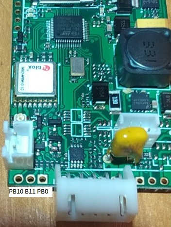

# Analiza płytki IoT Blinkee

Dokumentacja połączeń i szkic diagnostyczny płytki hulajnogi z **STM32F030CCT6**, modemem **SARA-G340**, GNSS **MAX-M8W** i akcelerometrem **KX124**.

[English](README.md) · [Piny i sprzęt](docs/HARDWARE.md) · [Diagnostyka i komendy](docs/DIAGNOSTICS.md) · [Kod](blinkee_iot_diag.ino)

## Zawartość

- Zdjęcia PCB, wykaz elementów, mapa sygnałów i opis 5-pinowego złącza ESC.
- Diagnostyka ADC/GPIO, skan I²C, test akcelerometru, GNSS i modemu.
- Terminal serwisowy: **115200 baud**, PB10 TX / PB11 RX.

Dokumentacja oznacza połączenia wymagające dalszego sprawdzenia. Dzielniki ADC, polaryzacja sterowania modemem i czasy impulsów w szkicu wymagają weryfikacji na konkretnej płytce. Wgranie diagnostyki zastępuje jej obecny firmware.

[Druga strona płytki](images/2.jpg)
