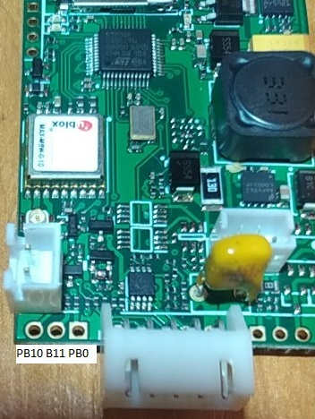
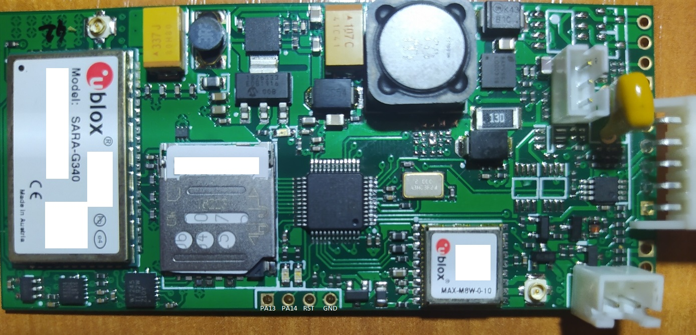

# Hardware reference

[Project](../README.md) · [Diagnostic sketch](DIAGNOSTICS.md)

This is the board mapping recorded during the original reverse-engineering work. Question marks and provisional labels remain unresolved; the sketch's pin declarations are implementation assumptions rather than additional measurement evidence.

## Main components

| Block | Component or connection |
| --- | --- |
| MCU | STM32F030CCT6 |
| Cellular modem | u-blox SARA-G340 |
| GNSS | u-blox MAX-M8W |
| Accelerometer | KX124, I²C address `0x1E` with SDO/SA0 at GND |
| Level translator | SN74AVC4T245PWT |
| Alarm | Onboard siren connector |
| ESC | 5-pin harness |
| Backup supply | Battery labelled 7.2 V in the board notes |

## MCU pin map

| Pin | Board signal | Status / note |
| --- | --- | --- |
| PB5 | GNSS power enable | Transistor enable |
| PB4 | GNSS UART TX | MCU to MAX-M8W RX |
| PB3 | GNSS UART RX | MAX-M8W TX to MCU |
| PA15 | GNSS TIMEPULSE | Input from MAX-M8W |
| PB14 | Accelerometer SDA | I²C |
| PB13 | Accelerometer SCL | I²C |
| PB12 | Accelerometer INT1 | Interrupt line |
| PB15 | Accelerometer INT2 | Interrupt line |
| PC13 | Scooter WAKEUP | Output |
| PA4 | Scooter UART A | Direction unresolved |
| PA5 | Scooter UART B | Direction unresolved |
| PC14 | Siren | Output |
| PA0 | Backup-battery ADC | Divider calibration required |
| PA1 | Main-battery ADC | Probable; confirm tracing |
| PA11 | SARA RESET_N | Direct control |
| PA12 | SARA PWR_ON | Direct control |
| PA9 | WT245 1A1 | Confirm modem UART direction |
| PA10 | WT245 2A1 | Confirm modem UART direction |
| PA8 | WT245 2A2 | Modem CTS path |
| PB0 | Test/config/service select | Unconfirmed |
| PB10 | Service/factory UART candidate | Used as TX by the sketch |
| PB11 | Service/factory UART candidate | Used as RX by the sketch |
| PF0 | HSE OSC_IN | 8 MHz oscillator |
| PF1 | HSE OSC_OUT | 8 MHz oscillator |

## Modem translator connections

| Translator pin | Recorded connection |
| --- | --- |
| 1A2 | GND |
| 1B1 | SARA TXD |
| 1B2 | Unknown; possible extra control |
| 2B1 | SARA RXD |
| 2B2 | SARA CTS |

The diagnostic sketch instantiates modem UART as `HardwareSerial(PA10, PA9)` (RX, TX). Verify the final direction against the translator and selected STM32 pin map before relying on that assignment. The sketch reads CTS as an input; it does not configure UART hardware flow control.

## ESC connector

Orientation follows the original board notes: **bottom to top**. Match it to the photos before using the numbering.

| Position | Signal |
| --- | --- |
| 1 | GND |
| 2 | UART A |
| 3 | UART B |
| 4 | WAKEUP |
| 5 | Main battery supply, labelled 42 V |

The main supply pin is separate from the UART logic signals.

## Open questions

- Confirm PA1 as the main-battery divider input.
- Identify WT245 1B2 and verify modem UART direction labels.
- Establish the exact role of PB0 / PB10 / PB11 factory pads.
- Capture modem boot/AT initialization behavior.

Motion wake-up, tamper detection and GNSS/modem wake sequencing are plausible uses of the mapped components, rather than verified behavior of the original firmware.

## Board photos

